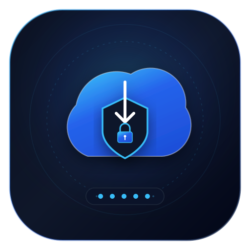

<p align="center">
  
</p>

# Bulwark Mail Drop - Secure Temporary File Server

A high-performance, secure temporary file storage microservice for **Bulwark Webmail (Mail Drop)**. Designed to handle large email attachments with automatic TTL expiration, PIN-code access protection, brute-force throttling, and responsive theme matching.

---

## 🚀 Key Features

1. **Unique Link & PIN Protection:**
   - Every upload receives a cryptographically secure 32-character hexadecimal identifier (`/file-server/{upload_id}`).
   - Access is protected by a 6-digit numeric PIN (auto-generated or user-specified).
   - Salted password hashing with **PBKDF2-HMAC-SHA256** (100,000 iterations).
   - **Brute-Force Protection:** Automatically locks access for 15 minutes after 5 failed PIN attempts.

2. **Automatic Lifecycle & Cleanup:**
   - Default retention period of **28 days** (configurable from 1 to 28 days).
   - Background worker deletes expired files and metadata hourly.

3. **Bulwark Webmail Integration:**
   - Synchronized with Bulwark dark/light themes via `localStorage` and system preferences.
   - Built-in multi-language support (English & Russian) with automatic detection based on Bulwark Webmail referrer, cookies (`NEXT_LOCALE`), and browser headers.
   - Interactive language switcher (`EN` / `RU`).

4. **Production Security:**
   - Direct web uploads are restricted. File uploads are permitted only via authorized Bulwark plugins using the `X-API-Key` header.
   - Strict input validation, filename sanitization, and size verification.

---

## 🛠️ REST API Specification

### 1. Upload Bundle (Protected by `X-API-Key`)
```http
POST /file-server/api/upload
X-API-Key: <your_secret_api_key>
Content-Type: multipart/form-data
```

**Parameters:**
- `files`: One or more files (up to 20 files, 10 GB each).
- `ttl_days` *(optional)*: Retention in days (1–28, default: 28).
- `pin` *(optional)*: 6-digit numeric PIN (e.g. `123456`). If omitted, generated automatically.

**Response `200 OK`:**
```json
{
  "success": true,
  "upload_id": "c8a419eb7b3749e7bdf4083d09a74421",
  "url": "https://mail.example.com/file-server/c8a419eb7b3749e7bdf4083d09a74421",
  "pin": "749201",
  "expires_at": "2026-12-16T12:00:00Z",
  "ttl_days": 28,
  "total_size": 157286400,
  "formatted_size": "150.0 MB",
  "files_count": 2,
  "files": [
    {
      "id": "f_1",
      "name": "Design_Project_v2.dwg",
      "size": 52428800,
      "formatted_size": "50.0 MB",
      "sha256": "e3b0c44298fc1c149afbf4c8996fb92427ae41e4649b934ca495991b7852b855",
      "content_type": "application/octet-stream"
    }
  ]
}
```

---

## 🐳 Quick Start with Docker Compose

```yaml
services:
  file-server:
    image: ghcr.io/crystalvega/file-server:latest
    container_name: file-server
    restart: unless-stopped
    environment:
      - PUBLIC_BASE_URL=https://mail.example.com
      - URL_PREFIX=/file-server
      - DEFAULT_TTL_DAYS=28
      - MAX_TTL_DAYS=28
      - MAX_FILE_SIZE_MB=10240
      - API_KEY=your_secure_api_key_here
    volumes:
      - file_server_data:/data
    labels:
      - "traefik.enable=true"
      - "traefik.http.routers.files.rule=Host(`mail.example.com`) && PathPrefix(`/file-server`)"
      - "traefik.http.routers.files.entrypoints=websecure"
      - "traefik.http.routers.files.tls=true"
      - "traefik.http.services.files.loadbalancer.server.port=8000"

volumes:
  file_server_data:
```

---

## ⚙️ Environment Variables

| Variable | Default | Description |
|---|---|---|
| `PUBLIC_BASE_URL` | *(from Host)* | Public base URL (e.g. `https://mail.example.com`) |
| `URL_PREFIX` | `/file-server` | Route prefix for UI and API |
| `API_KEY` | *(empty)* | Secret key required for `X-API-Key` authentication |
| `DEFAULT_TTL_DAYS` | `28` | Default retention period in days |
| `MAX_TTL_DAYS` | `28` | Maximum allowed retention in days |
| `MAX_FILE_SIZE_MB` | `10240` | Maximum file size in MB (10 GB) |
| `DATA_DIR` | `/data` | Directory where uploaded files and metadata are stored |
| `SECRET_KEY` | *(auto-generated)* | Key for signing session authentication cookies |

---

## 📄 License
MIT License.
